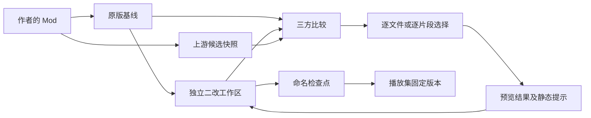

# Roadmap 2：本地二改与作者更新并行 · 0.23.0

本轮将启动器扩展为可维护的本地 Mod 项目：原作者的 Steam／Paradox 更新进入候选区，自己的版本在独立工作区继续修改；只有经过选择的内容才合入工作区。

| 阶段            | 已实现的结果                                                                        | 验收重点                                                       |
| --------------- | ----------------------------------------------------------------------------------- | -------------------------------------------------------------- |
| R2-1 本地项目   | 从已安装 Mod、文件夹、ZIP 创建独立副本；原始来源与本地发布身份分离；可离线修改      | 原版删除或更新不覆盖二改，副本不继承原作者发布 ID              |
| R2-2 跟踪上游   | Steam 原始安装目录抓取、Paradox 已验签完整包、手工 ZIP 候选；原版基线与候选分开保存 | 获取候选不切换当前工作区；来源、账号或文件变化时停止           |
| R2-3 选择合并   | 逐文件采纳、保留、暂缓；文本三方自动合并、逐片段选择与手动编辑；二进制完整文件选择  | 保存合并前版本、校验过期计划、逐文件推进基线、异常恢复         |
| R2-4 版本与备份 | 命名检查点、恢复内容及对应基线、播放集固定检查点、原生 ZIP 备份导入导出             | 工作区继续编辑时稳定播放集仍使用固定内容；备份导入生成独立身份 |
| R2-5 HOI4 辅助  | 国策／事件／本地化等分类，重复 ID、引用和 descriptor 静态提示，预览实际选择后的结果 | 评论和字符串不误认脚本定义；提示不等同游戏或存档兼容性验证     |

## 使用流程

1. 打开“本地项目”→“创建二改项目”，选择已安装 Mod、本地文件夹或 ZIP。确认来源没有个人修改时才勾选原版基线；已改过或无法确认则保持未知。
2. “打开工作区”后用自己的编辑器修改文件；“历史版本”可以保存命名检查点。
3. 在“上游更新”检查并获取作者版本，或从 ZIP 导入候选。Steam 需要先在工坊页连接客户端；Paradox 默认匿名，可选择当前账号访问其有权下载的内容。
4. 点击“比较并准备合并”，按文件选择处理方式。点击文本文件可查看三方内容，展开“逐片段选择”分别取舍，生成结果后仍可手动调整并保存选择。
5. 预览实际合并结果及静态提示，确认后应用。暂缓项保留旧基线，会在后续比较中继续出现；明确保留本地表示本次上游改动已处理。
6. 在当前播放集中使用工作区，或把某个检查点固定到当前播放集。完整二改与其原版同时启用会阻止启动；使用项目的快捷操作会停用原版并保留播放集成员。

未知基线可以进行明确选择。完成全部文件审阅后建立今后比较使用的基线，不追认最初导入的副本是作者原版。改变上游关联同样不会制造共同祖先。新增／删除文件、超限文本和不支持的编码使用完整文件流程。

## 存储与边界

- 工作区位于当前 HOI4 用户目录的 `mod/ironclad_project_<uuid>/`；快照及项目记录位于启动器数据目录的 `mod-projects/projects/<uuid>/`。更换游戏用户目录后需切回项目所属目录操作。
- 快照为独立普通文件，并核验 SHA-256；不使用指向作者目录的链接。合并及恢复保留旧树，外部编辑造成恢复歧义时停止并保留证据。
- 当前采用完整快照，没有增量存储或自动历史清理；大型 Mod 多次保存会明显增加磁盘用量。单次树上限 20 GiB、100000 文件；文本合并每个文件不超过 1 MiB，并有计算预算。
- 上游候选下载支持取消，当前没有项目候选下载的跨重启续传。正常下载临时包会在验证后清理；不能证明归属或被外部修改的内容保留并显示路径，异常退出遗留文件可能需人工检查。
- 项目备份用于携带本地内容与历史；官方播放集 JSON 不含本地项目文件。候选快照与逐文件合成基线不能固定为可玩版本。
- 本轮不包含自动理解玩法意图、自动补齐所有语义依赖或 AI 改写。静态分析只查看有界的项目文件；合并后的玩法、游戏版本和存档仍需实际游戏验证。

## 验证记录

2026-10-30：系统 Node 全套 **1298/1298** 通过，失败／取消／跳过均为 0；项目界面 **13 项**、常规界面 **54 项**、播放集 **35 项**及多语言流程通过。真实隐藏 Electron **4 项**检查覆盖 sandbox preload、原生 IPC 创建项目、检查点与播放集固定版本、界面渲染。1000px 完整加载界面及同文件两处冲突分别取舍的截图已人工核对。

首轮全套暴露了旧主进程测试夹具未接入项目依赖，以及新增 IPC 名称不符合现有约定；已补齐夹具和实际主进程保护回归，并统一通道名后全套重跑通过。UI 脚本也修正了重复标题定位及文本框明确标签；保留首轮失败证据。最终源码格式检查通过。

最终验证结果及便携包摘要记录在 `test-results/0.23.0/verification-summary.json`。后端使用隔离文件、签名夹具及伪造 Steam 适配器；界面测试使用真实项目服务与浏览器，桌面测试使用真实隔离 Electron、sandbox preload 和 IPC。未对真实账号执行订阅、发布或下载操作，未启动真实游戏。

这份路线图记录本轮本地项目实现。Roadmap 1 的通用补丁兼容及真实服务验收状态仍以根目录 `ROADMAP.md` 为准。精确接口与持久化语义见 [实现合同](roadmap-2-contract.md)。
